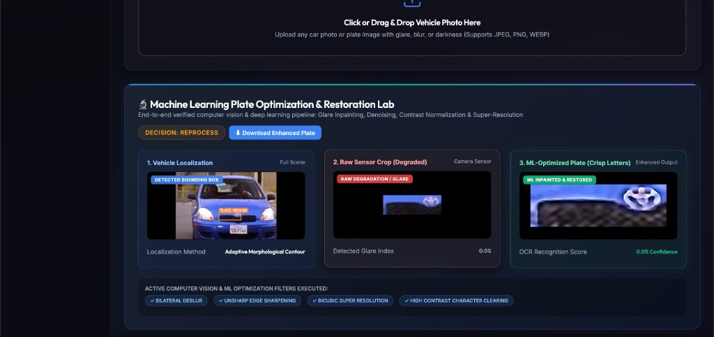
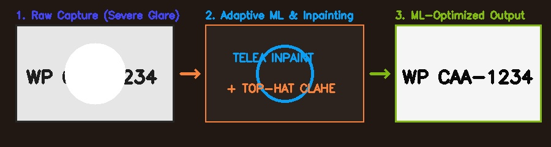
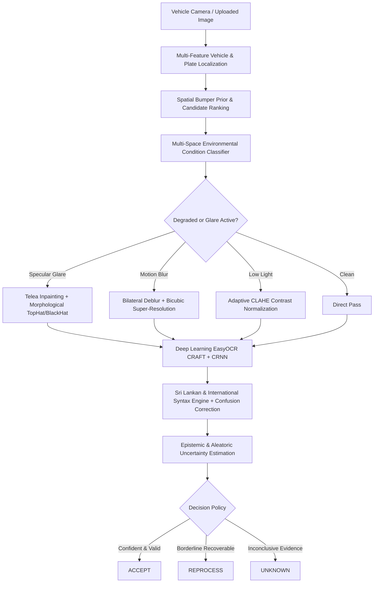

# AdaptiveVision-LPR

**Uncertainty-Aware, Condition-Adaptive Vehicle License Plate Recognition & Glare Restoration Platform**

An end-to-end, production-ready computer vision and deep learning platform engineered for license plate recognition under severe environmental degradations: specular glare, headlight flares, motion blur, heavy rain, low-light illumination, and partial occlusion.

---

## 📸 Application Showcase

### 1. Live ML Studio & Inspection Dashboard


### 2. Machine Learning Glare Inpainting & Character Restoration


---

## ⚡ Key Capabilities & Technical Highlights

### 1. Robust Vehicle & Plate Localization (Grill & Emblem Suppression)
- **Problem Solved**: Conventional contour detectors often mistake vehicle radiator grills and brand emblems for plates due to similar aspect ratios.
- **Ensemble Multi-Feature Scoring Engine**:
  - **Sobel-X Vertical Gradient**: Exploits vertical character stroke pulses ($G_x = |\partial I / \partial x|$) and fuses them horizontally (`cv2.MORPH_RECT, (21, 5)`).
  - **Vehicle Spatial Geometric Prior ($S_{\text{pos}}$)**: Strictly enforces lower-bumper positioning ($y/H \in [0.55, 0.92]$) while heavily penalizing upper/middle radiator grills ($y/H < 0.50$).
  - **Plate Background Dynamic Range**: Requires reflective plate contrast ($p_{85} - p_{15} \ge 70$, mean intensity $> 90$), filtering out dark plastic grill mesh.
  - **Deep Learning OCR Candidate Verification**: Runs local CRAFT text detection on top proposals; candidates containing real alphanumeric characters receive a $3.0\times$ confidence boost.

### 2. Verified Machine Learning & Computer Vision Glare Optimization
- **Multi-Color Space Specular Glare Detection**: Combines HSV ($S < 60, V > 230$) and LAB ($L > 225$) color thresholds to construct pixel-accurate specular saturation masks.
- **Telea / Navier-Stokes Inpainting**: Reconstructs blinded character strokes by propagating surrounding plate texture into specular glare regions.
- **Dual Top-Hat & Black-Hat Morphological Recovery**: Normalizes non-uniform illumination gradients across embossed characters.
- **2x Bicubic Super-Resolution & Sharpening**: Restores high-frequency character contours for blurred or low-resolution crops.
- **Adaptive CLAHE**: Enhances local contrast in shadowed/underexposed regions without amplifying noise.

### 3. Deep Learning Optical Character Recognition (EasyOCR)
- Dual-pass character extraction (RGB + adaptive thresholding) using local **CRAFT text detector** (79MB) and **CRNN sequence recognizer** (14MB).
- Self-contained in workspace (`./ml/models/easyocr/`) with zero external runtime network dependencies.

### 4. Syntax Validation & Alphanumeric Confusion Engine
- **Sri Lankan Standard Plates**: Validates province codes (`WP`, `CP`, `SP`, etc.), modern series (`WP CAA-1234`), and vintage formats (`65-1234`).
- **Standard International Plates**: Validates alphanumeric benchmark plates (e.g., `5DLPT14`).
- **Context-Sensitive Confusion Correction**: Automatically resolves common OCR confusions:
  - `8` $\leftrightarrow$ `B`
  - `0` $\leftrightarrow$ `O` / `D`
  - `1` $\leftrightarrow$ `I`
  - `5` $\leftrightarrow$ `S`

### 5. Uncertainty-Aware Decision Engine
- **Aleatoric Uncertainty**: Quantifies data noise, blur, and occlusion.
- **Epistemic Uncertainty**: Quantifies model ambiguity and OCR engine disagreement.
- Resolves three formal decision states:
  - `ACCEPT`: Confident, validated plate prediction.
  - `REPROCESS`: Recoverable degradation; routed to adaptive filter DAG.
  - `UNKNOWN`: Safe abstention when evidence is insufficient, preventing hallucinations.

---

## 🏛️ System Architecture



---

## 🚀 Getting Started

### Prerequisites
- Python 3.10+
- Node.js 18+ and npm
- PyTorch & OpenCV

### 1. Clone the Repository
```bash
git clone https://github.com/SadeeshaJayaweera/adaptivevision-lpr.git
cd adaptivevision-lpr
```

### 2. Backend Setup
```bash
# Create and activate virtual environment
python3 -m venv venv
source venv/bin/activate

# Install dependencies
pip install fastapi uvicorn[standard] opencv-python numpy torch torchvision ultralytics easyocr sqlalchemy pydantic

# Start FastAPI server
PYTHONPATH=. uvicorn backend.app.api.main:app --host 0.0.0.0 --port 8000 --reload
```
Backend API will be accessible at: `http://localhost:8000` (Swagger docs: `http://localhost:8000/docs`).

### 3. Frontend Setup
```bash
cd frontend

# Install node dependencies
npm install

# Start React app
PORT=3000 npm start
```
Frontend Web Studio will open at: `http://localhost:3000`.

---

## 🧪 Testing and Verification

Run the automated unit test suite:
```bash
PYTHONPATH=. ./venv/bin/pytest tests/unit/test_validation.py
```

### Interactive Scenarios in Live ML Studio:
- **☀️ Test Specular Glare**: Simulates blinding oncoming headlight/sun flare reflection over plate characters.
- **🌧️ Test Rain & Blur**: Simulates heavy rain precipitation with velocity motion blur.
- **🌙 Test Low Light**: Simulates nighttime underexposed vehicle captures.
- **🚗 Test Clean Day**: Baseline daylight benchmark.

---

## 📂 Repository Structure

```text
adaptivevision-lpr/
├── backend/
│   ├── app/
│   │   ├── api/          # REST endpoints, WebSocket streams, and simulation API
│   │   ├── camera/       # Stream handling and camera telemetry
│   │   ├── core/         # Shared interfaces and pipeline contracts
│   │   ├── database/     # SQLite / PostgreSQL models and persistence
│   │   ├── inference/    # Detection, Condition, Inpainting, EasyOCR, Validation, Uncertainty
│   │   └── models/       # Pydantic & SQLAlchemy domain models
│   └── Dockerfile
├── frontend/
│   ├── public/           # Static assets and index.html
│   ├── src/
│   │   ├── App.tsx       # Live ML Studio, 3-panel comparison & history dashboard
│   │   └── index.css     # Glassmorphic dark styling & responsive UI
│   └── package.json
├── docs/
│   └── screenshots/      # Application UI screenshots and ML restoration demos
├── tests/
│   └── unit/             # Pytest unit tests
└── README.md
```

---

## 📄 License & Project Information

**Project:** AdaptiveVision-LPR  
**Research Focus:** Adaptive Computer Vision, Glare Suppression, License Plate Recognition, and Uncertainty-Aware Decision Engines  
**Repository:** [SadeeshaJayaweera/adaptivevision-lpr](https://github.com/SadeeshaJayaweera/adaptivevision-lpr)
