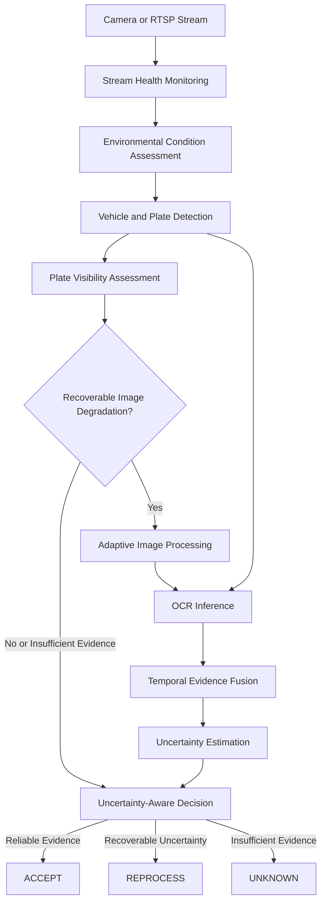

# AdaptiveVision-LPR

**Adaptive Vision-Based License Plate Recognition Under Adverse Environmental Conditions**

An uncertainty-aware, condition-adaptive license plate recognition research platform designed to improve recognition reliability under challenging environmental conditions, including low illumination, heavy rain, glare, motion blur, and partial plate occlusion.

AdaptiveVision-LPR explores an alternative to conventional fixed-sequence license plate recognition pipelines. Rather than relying exclusively on vehicle detection followed by optical character recognition (OCR), the platform introduces environmental condition assessment, plate visibility analysis, adaptive image processing, temporal evidence aggregation, and uncertainty-aware decision-making.

The system is designed to distinguish between **reliable recognition, recoverable visual degradation, and insufficient evidence**. When the available visual evidence cannot support a trustworthy prediction, the intended decision policy is to return `UNKNOWN` rather than force an unreliable plate identification.

---

## Table of Contents

- [Research Objectives](#research-objectives)
- [Key Capabilities](#key-capabilities)
- [System Architecture](#system-architecture)
- [Recognition Pipeline](#recognition-pipeline)
- [Technology Stack](#technology-stack)
- [Repository Structure](#repository-structure)
- [Getting Started](#getting-started)
- [Configuration and Deployment](#configuration-and-deployment)
- [Research Evaluation](#research-evaluation)
- [Limitations and Responsible Use](#limitations-and-responsible-use)
- [License](#license)

---

## Research Objectives

AdaptiveVision-LPR investigates how an adaptive perception pipeline can improve license plate recognition reliability when visual conditions are less than ideal.

The primary objectives are to:

- **Adapt processing to environmental conditions:** Select appropriate enhancement operations according to observed image degradation rather than applying every operation indiscriminately.
- **Estimate plate visibility and recoverability:** Identify cases where visual degradation may prevent reliable character recognition.
- **Aggregate evidence across video frames:** Reduce sensitivity to transient OCR errors by combining observations over time.
- **Quantify prediction uncertainty:** Incorporate recognition confidence and model disagreement into downstream decisions.
- **Validate region-specific plate formats:** Apply Sri Lankan license plate format constraints to help identify implausible predictions.
- **Support degraded-stream operation:** Monitor camera and stream health to inform processing policies under unstable operating conditions.

The overarching research question is:

> Can condition-aware processing, temporal evidence fusion, and uncertainty-aware decision-making improve license plate recognition reliability compared with a conventional detection-and-OCR pipeline?

## Key Capabilities

### 1. Condition-Aware Image Processing

Environmental conditions can significantly affect license plate visibility. The proposed adaptive routing layer assesses degradation characteristics and selects suitable image-processing operations.

Potential processing techniques include:

- Contrast Limited Adaptive Histogram Equalization (CLAHE) for local contrast enhancement.
- Unsharp masking for controlled sharpening.
- Deblurring techniques for motion-degraded images.
- Super-resolution methods for low-resolution plate regions.
- Glare and illumination correction for challenging lighting conditions.

Processing decisions should depend on the detected degradation type, image quality, and computational cost. Enhancement is not guaranteed to recover information that is absent from the original image.

### 2. Plate Visibility and Recoverability Assessment

The visibility analysis layer evaluates whether a detected plate contains sufficient visual evidence for recognition.

Relevant degradation factors include:

- Partial occlusion by objects or other vehicles.
- Mud, dirt, and physical damage.
- Motion blur and defocus.
- Insufficient resolution.
- Severe overexposure or underexposure.

An explicit `IVisibilityAnalyzer` interface can separate visibility assessment from downstream recognition logic. Frames that are unlikely to produce reliable recognition can be rejected, deferred, or routed through an appropriate recovery operation.

### 3. Temporal Evidence Fusion

Individual OCR predictions may vary across consecutive video frames. Temporal fusion aims to improve consistency by aggregating evidence from multiple observations of the same vehicle or plate.

The proposed approach includes:

- Aligning observations associated with the same plate.
- Comparing character-level predictions across frames.
- Accounting for differences in recognition confidence and image quality.
- Reducing the influence of transient recognition errors.
- Producing a consolidated prediction when sufficient evidence is available.

A Bayesian fusion strategy can provide a principled framework for combining character-level evidence. Its effectiveness depends on correct temporal association, appropriate probability calibration, and the treatment of correlated observations.

### 4. Uncertainty-Aware Decision-Making

Recognition confidence alone does not guarantee that a predicted plate is correct. AdaptiveVision-LPR therefore investigates decision-making that accounts for uncertainty and evidence quality.

Two relevant uncertainty categories are:

- **Aleatoric uncertainty:** Uncertainty arising from inherent ambiguity in the observed image, such as severe blur or occlusion.
- **Epistemic uncertainty:** Uncertainty associated with model limitations, which may be investigated through model disagreement or other appropriate estimation techniques.

The decision layer is designed around three possible outcomes:

| Decision | Intended behavior |
|---|---|
| `ACCEPT` | Accept a prediction when the evidence satisfies the configured reliability criteria. |
| `REPROCESS` | Attempt an alternative processing strategy when the degradation appears recoverable. |
| `UNKNOWN` | Abstain when the available evidence is insufficient for a reliable identification. |

Thresholds should be calibrated against a representative validation dataset. These decisions should not be interpreted as guarantees of correctness.

### 5. Sri Lankan License Plate Validation

A region-specific validation component, represented by the `IValidationEngine` interface, is intended to incorporate Sri Lankan registration-format constraints into the recognition workflow.

Potential functionality includes:

- Checking predictions against supported registration patterns.
- Identifying implausible character sequences.
- Applying context-sensitive OCR confusion correction.
- Separating syntactic validity from actual visual recognition confidence.

Format validation should act as supporting evidence rather than proof of vehicle identity. Character corrections must not override contradictory image evidence or manufacture missing characters.

### 6. Camera Health and Degraded-Stream Monitoring

The camera monitoring layer is designed to observe operational conditions that may affect recognition performance.

Relevant telemetry includes:

- Stream availability and connection interruptions.
- Frame rate and frame delivery delays.
- Network jitter and latency.
- Processing throughput and backlog.
- Recognition and rejection rates.

These measurements can inform degraded-operation policies, including prioritizing recent frames, adjusting processing effort, or reporting unavailable camera feeds.

**Important distinction:** Camera health monitoring describes operational reliability; it does not, by itself, establish disaster resilience.

---

## System Architecture

AdaptiveVision-LPR is organized around an adaptive processing workflow in which recognition decisions can depend on environmental conditions, image quality, and accumulated evidence.



The diagram represents the intended logical architecture. Actual execution paths depend on the components implemented in the repository.

### Architectural Principles

- **Modularity:** Detection, visibility assessment, enhancement, OCR, fusion, and decision logic should remain independently testable.
- **Conditional computation:** Expensive processing operations should be invoked only when justified by image conditions and expected benefit.
- **Evidence preservation:** The original image and intermediate predictions should remain available for auditing and evaluation.
- **Graceful degradation:** Poor-quality input should result in a controlled failure or abstention rather than an unsupported identification.
- **Observable operation:** Pipeline latency, stream health, processing outcomes, and recognition failures should be measurable.

---

## Recognition Pipeline

The proposed processing sequence is:

1. **Acquire:** Read images or frames from a camera or video stream.
2. **Assess stream health:** Monitor frame availability, latency, and operational interruptions.
3. **Classify conditions:** Estimate relevant environmental and image degradation characteristics.
4. **Detect:** Identify vehicles and candidate license plate regions.
5. **Assess visibility:** Estimate whether the plate contains enough usable visual evidence.
6. **Adapt:** Apply an appropriate enhancement strategy when further processing is justified.
7. **Recognize:** Generate OCR predictions from the original or processed plate image.
8. **Fuse evidence:** Aggregate temporally associated predictions where multiple observations are available.
9. **Estimate uncertainty:** Evaluate prediction reliability using the configured uncertainty strategy.
10. **Decide:** Accept the prediction, request reprocessing, or return `UNKNOWN`.

The pipeline should retain enough intermediate information to explain why a prediction was accepted, reprocessed, or rejected.

---

## Technology Stack

The following table describes the intended technology stack; individual dependencies and versions should be verified against the project configuration.

| Layer | Technologies |
|---|---|
| Computer vision and machine learning | PyTorch, OpenCV, Ultralytics YOLO, EasyOCR |
| Backend API | Python 3.11, FastAPI, Uvicorn |
| Data validation | Pydantic |
| Persistence | SQLAlchemy, PostgreSQL |
| Asynchronous processing | Python AsyncIO, Redis |
| Frontend | React 18, TypeScript, CSS |
| Deployment | Docker, Docker Compose |
| API exploration | FastAPI interactive documentation |

Additional OCR engines, such as PaddleOCR, may be incorporated where configured and evaluated.

---

## Repository Structure

```text
adaptivevision-lpr/
├── backend/
│   ├── app/
│   │   ├── api/          # REST endpoints and WebSocket interfaces
│   │   ├── camera/       # Stream handling and camera telemetry
│   │   ├── core/         # Shared interfaces and pipeline contracts
│   │   ├── database/     # Database configuration and persistence
│   │   ├── inference/    # Detection, enhancement, OCR, fusion,
│   │   │                 # visibility, and uncertainty components
│   │   └── models/       # Domain models and validation schemas
│   └── Dockerfile
├── frontend/
│   ├── src/
│   │   ├── App.tsx       # Main dashboard
│   │   └── index.css     # Global styling
│   └── Dockerfile
├── ml/                   # Model artifacts, experiments, notebooks
├── data/                 # Dataset assets and annotations
├── scripts/              # Dataset utilities and experiment tools
├── docs/                 # Research methodology and documentation
└── docker-compose.yml
```

Directory names and component descriptions should be updated to match the actual repository contents.

---

## Getting Started

### Prerequisites

- Git
- Docker and Docker Compose
- Sufficient memory and storage for the selected models and datasets
- Optional compatible NVIDIA GPU and CUDA environment for accelerated inference

CPU execution may be possible depending on the selected models and configuration. Apple Silicon acceleration through PyTorch MPS depends on compatibility with the installed dependencies.

### 1. Clone the Repository

```bash
git clone https://github.com/SadeeshaJayaweera/adaptivevision-lpr.git
cd adaptivevision-lpr
```

### 2. Configure the Environment

Review the project's environment-variable template, if available, and configure the required database, Redis, model, and application settings.

Do not commit credentials, API keys, database passwords, or other secrets to version control.

### 3. Build and Start the Services

If the repository contains a compatible Compose configuration:

```bash
docker compose up --build -d
```

Inspect service health and startup logs:

```bash
docker compose ps
docker compose logs -f
```

### 4. Access the Application

When the Compose configuration exposes the default ports, use:

| Service | Local address |
|---|---|
| Frontend dashboard | http://localhost:3000 |
| FastAPI interactive documentation | http://localhost:8000/docs |

The actual ports and service availability depend on `docker-compose.yml` and the environment configuration.

### 5. Stop the Services

```bash
docker compose down
```

To remove persisted database volumes as well, review the Compose configuration before using volume-removal options. Doing so may permanently delete stored data.

---

## Research Evaluation

A research-oriented LPR platform should be evaluated using reproducible experiments rather than qualitative demonstrations alone.

Recommended evaluation dimensions include:

| Evaluation area | Suggested measurements |
|---|---|
| Plate detection | Precision, recall, mean average precision |
| Character recognition | Character error rate, exact plate match rate |
| Reliability | False acceptance rate, false rejection rate |
| Uncertainty | Calibration error, risk–coverage curves |
| Temporal fusion | Accuracy improvement over single-frame OCR |
| Adaptive processing | Accuracy improvement and added computational cost |
| Abstention | Error rate among accepted predictions and unknown rate |
| Runtime performance | End-to-end latency, throughput, resource utilization |
| Degraded conditions | Performance grouped by lighting, weather, blur, and occlusion |

### Suggested Baselines

Compare the proposed approach against:

1. A conventional detection-plus-OCR pipeline.
2. A pipeline with image enhancement but no temporal fusion.
3. A pipeline with temporal fusion but no adaptive processing.
4. The complete adaptive pipeline.

Where feasible, use identical evaluation splits, consistent preprocessing, and clearly documented hardware and model configurations.

Ablation studies should isolate the contribution of each major component. Report results separately for adverse environmental conditions instead of relying exclusively on an overall accuracy score.

No performance improvement should be claimed until supported by measured experimental results.

---

## Limitations and Responsible Use

License plate recognition is sensitive to image quality, regional registration conventions, environmental conditions, and the representativeness of training and evaluation data.

AdaptiveVision-LPR is a research platform and should not be assumed to provide operationally validated or safety-critical identification without appropriate testing.

Key considerations include:

- **No guaranteed recovery:** Image enhancement cannot reliably reconstruct every character obscured by physical damage or missing visual information.
- **Confidence is not correctness:** A high model score does not establish that a recognized plate is accurate.
- **Regional limitations:** Sri Lankan format validation should be restricted to explicitly supported formats and verified against reliable references.
- **Privacy:** Video frames and recognized registration numbers may contain sensitive information. Apply appropriate access controls, retention limits, and data-protection practices.
- **Operational validation:** Real-world deployment requires representative testing, monitoring, security review, and documented failure handling.
- **Disaster readiness:** Disaster-resilient operation requires broader validation of power, connectivity, infrastructure availability, data durability, and recovery procedures.

When evidence is insufficient, abstention is preferable to presenting an unsupported identification as reliable.

---

## License

No license has been specified in this document. Add an appropriate open-source license to the repository if you intend to permit public reuse, modification, or redistribution. Until a license is included, do not assume that the repository is available for unrestricted reuse.

---

## Project Information

**Project:** AdaptiveVision-LPR  
**Research focus:** Adaptive computer vision, license plate recognition, temporal evidence fusion, and uncertainty-aware inference  
**Repository:** [SadeeshaJayaweera/adaptivevision-lpr](https://github.com/SadeeshaJayaweera/adaptivevision-lpr)

For research collaboration, technical discussion, or evaluation methodology, open an issue or discussion in the repository when those features are enabled.
